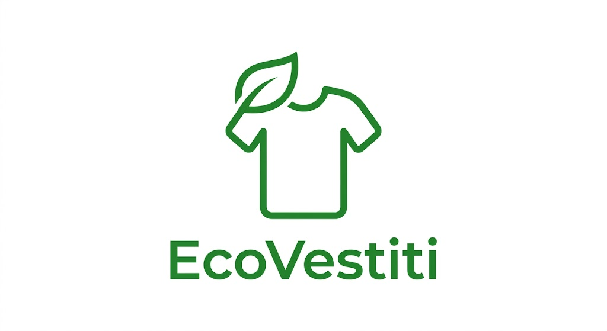

# EcoVestiti - Abbigliamento Sostenibile

## Documentazione del progetto e-commerce

EcoVestiti è una piattaforma e-commerce dedicata alla vendita di abbigliamento 100% sostenibile, realizzata nel totale rispetto della natura. Il sito offre capi di alta qualità prodotti con tessuti naturali e riciclati, coloranti ecologici e processi a zero sprechi d'acqua, consentendo agli utenti di registrarsi, esplorare il listino e contattare facilmente l'azienda.

---

## Funzionalità

* Ricerca dei prodotti per categoria, taglia e prezzo
* Aggiunta dei prodotti al carrello
* Gestione degli ordini e registrazione utente
* Tracciamento della spedizione
* Area di contatto dedicata tramite email

### Categorie di prodotti:
* Abbigliamento uomo
* Abbigliamento donna
* Accessori ecologici

---

## Tabella dei prodotti

| CodiceProdotto | Prodotto | Categoria | Taglia | Prezzo | Disponibilità |
| :--- | :--- | :--- | :--- | :--- | :--- |
| ECO-001 | Maglietta Base | Abbigliamento uomo | M | 10 Euro | Disponibile |
| ECO-002 | Felpa con Cappuccio | Abbigliamento uomo | L | 35 Euro | Disponibile |
| ECO-003 | Pantaloni Casual | Abbigliamento donna | S | 45 Euro | Diponibile |
| ECO-004 | Giacca Antivento | Abbigliamento uomo | M | 60 Euro | Disponibile |
| ECO-005 | Calzini Ecologici | Accessori | Unica | 8 Euro | Esaurito |

---

## Link e citazione

Puoi consultare la guida completa per formattare i testi visitando la [Documentazione ufficiale di Markdown](https://www.markdownguide.org/).

> Una buona documentazione deve essere chiara, aggiornata e comprensibile anche da chi non ha sviluppato il progetto.

---

## Immagini e collegamenti

### Contatti
Hai domande o vuoi maggiori informazioni? Scrivici subito a: [info@ecovestiti.it](mailto:info@ecovestiti.it)
